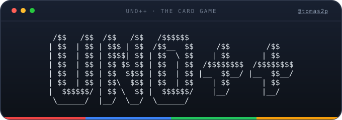

<div align="center">
  <a href="https://tomas2p.vercel.app">
    
  </a>

  [](https://github.com/tomas2p/UNO_card_game/releases)
  [](LICENSE)
  [](https://github.com/tomas2p/UNO_card_game/actions/workflows/ci.yml)
  [](https://isocpp.org/)
</div>

Juego de UNO para terminal escrito en C++17. Incluye baraja completa, turnos,
cartas especiales, IA, sistema de gritar UNO y reciclado del mazo de descarte.

## Versión

La versión se define en el archivo `VERSION` y se incrusta en el binario junto
con el commit de git:

```sh
./game_uno++ --version
# UNO++ 1.0.0 (commit <hash>)

./game_uno++ --help
```

`make check-version` comprueba que `VERSION` es SemVer y que `CHANGELOG.md`
tiene una sección para esa versión. La CI ejecuta esta comprobación en cada
push.

## Estado

- [x] Crear la baraja (112 cartas)
- [x] Ver la baraja
- [x] Barajar
- [x] Sistema de turnos
- [x] Cambio de color (comodín)
- [x] Cambio de sentido (reversa)
- [x] Pila de juego / descarte
- [x] Cartas especiales +2 y +4
- [x] Gritar UNO
- [x] Jugadores IA
- [ ] Juego online

## Requisitos

- Compilador con C++17 (`g++` o `clang++`)
- `make`
- Terminal de al menos 80x30
- Ejecutar desde la raíz del proyecto (los textos viven en `resources/`)

## Compilar y ejecutar

```sh
make          # compila en build/ y genera ./game_uno++
make run      # compila si hace falta y arranca el juego
./game_uno++  # ejecución directa
make clean    # borra build/ y el binario
```

La compilación usa `-Wall -Wextra -Wpedantic`. El binario y `build/` están
ignorados por git.

## Integración continua

El workflow `.github/workflows/ci.yml` se ejecuta en cada push a `main`, en
pull requests y manualmente. Valida versión y changelog, compila y prueba con
**gcc** y **clang** usando `-Werror`, verifica `--version`, hace un smoke test
del menú y publica el binario como artefacto de la ejecución.

## Publicar una versión

1. Actualiza `VERSION` y añade la sección correspondiente en `CHANGELOG.md`.
2. Comprueba la coherencia con `make check-version`.
3. Crea y sube el tag:

```sh
git tag -a v1.0.0 -m "UNO++ 1.0.0"
git push origin main --tags
```

El workflow `.github/workflows/release.yml` se dispara con el tag `v*`,
comprueba que coincide con `VERSION`, compila, prueba y publica en GitHub
Releases el tar.gz con el binario, `resources/`, la documentación y su
checksum SHA-256.

## Changelog

El historial de versiones está en [CHANGELOG.md](CHANGELOG.md), con formato
Keep a Changelog. Cada versión publicada debe tener allí su sección; la CI y
el release lo verifican.

## Tests

```sh
make test
```

Las pruebas cubren la composición de la baraja, `IsPlayable` (incluida la
restricción del +4), el robo/descarte del jugador, el reparto inicial, el
grito de UNO con su penalización y partidas simuladas de 2 a 8 jugadores
(siempre terminan y ninguna carta se pierde).

## Controles

En el menú principal se elige la opción con su número. Dentro de una partida
contra la IA:

- `1` poner una carta (se pide la posición, desde 1)
- `2` coger una carta
- `3` gritar UNO++ (con 1 o 2 cartas)
- `4` opciones de depuración (muestra todas las manos)
- `0` abandonar la partida

Al jugar un comodín se elige el color de la mesa. Si no tienes ninguna carta
jugable, la opción `1` coge una del mazo.

## Reglas implementadas

- Se puede jugar una carta del mismo color o del mismo tipo; los comodines
  `< >` siempre se pueden jugar.
- El `+4` solo es legal si no tienes ninguna carta del color actual.
- La partida empieza con una carta de número.
- Reversa invierte el sentido (con dos jugadores actúa como bloqueo).
- Bloqueo salta al siguiente jugador.
- +2 y +4 hacen robar al siguiente jugador y le saltan el turno.
- Debes gritar UNO++ con 1 o 2 cartas. Si juegas tu penúltima carta sin
  haber gritado, robas 2 cartas. La IA siempre grita.
- Si el mazo se agota, se rebarajan todas las cartas del descarte menos la de
  arriba.
- La IA prioriza cartas no comodín y, si juega un comodín, elige el color que
  más tiene.
- Gana quien se queda sin cartas.

## Estructura

| Archivo | Responsabilidad |
| --- | --- |
| `src/card_class.*` | `Card`, `Color`, `Type`, formato y `IsPlayable` |
| `src/card_pack_class.*` | baraja/mano y barajado |
| `src/player_class.*` | nombre, mano y operaciones de robo/descarte |
| `src/game_class.*` | motor: turnos, efectos, UNO, reciclado y ganador |
| `src/game_ia.cc` | interfaz de la partida contra la IA |
| `src/uno_main.cc` | menú principal y flags de línea de comandos |
| `src/uno_tools.*` | entrada validada, limpieza de pantalla y recursos |
| `src/ansi_colors.h` | constantes ANSI (`ansi::`) |
| `src/version.h` | versión y commit mostrados por el binario |
| `VERSION` | versión semántica actual |
| `CHANGELOG.md` | historial de cambios por versión |
| `LICENSE` | texto de la GPL-3.0-or-later |
| `resources/` | logo y textos por secciones |
| `docs/logo.svg` | logo ASCII del README |
| `tests/uno_test.cc` | pruebas sin dependencias externas |
| `scripts/check_version.sh` | coherencia entre `VERSION`, changelog y tag |
| `.github/workflows/ci.yml` | CI con gcc, clang, tests y artefacto |
| `.github/workflows/release.yml` | release automático en tags `v*` |

## Licencia

Copyright (C) 2026 Tomás Pino Pérez.

Este proyecto se distribuye bajo la **GNU General Public License v3.0 o
posterior** (`GPL-3.0-or-later`). Consulta [LICENSE](LICENSE) para el texto
completo.

## Autor

Tomás Pino Pérez · [tomas2p.vercel.app](https://tomas2p.vercel.app)
